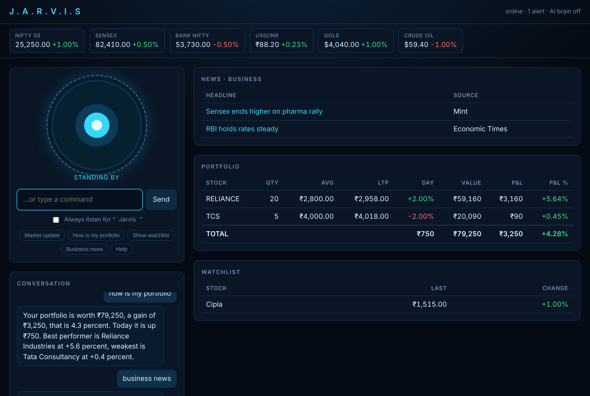

# J.A.R.V.I.S — voice assistant with an investing desk

A voice-controlled personal assistant in the spirit of
[GauravSingh9356/J.A.R.V.I.S](https://github.com/GauravSingh9356/J.A.R.V.I.S), rebuilt from scratch and
extended for an investing business: live Indian and global market prices, portfolio P&L, watchlist,
price alerts, investment calculators and market news — all by voice.



*(Screenshot uses sample data.)*

## Use it on the web

Open **https://claude.ai/artifact/GdshmbfnqouLUyMmNnVscd** (signed in to Claude). The web version is a voice-first business assistant:

- **Tasks and reminders** in plain speech, with priorities and due dates.
- **Gmail, Google Calendar and Google Drive** through your Claude connectors. Anything that changes your accounts waits for your approval, and Jarvis never sends email.
- **Daily briefing**, plus Business, Focus, Content and Research modes.
- **Your own workflows**, with approval checkpoints and run history.
- **Content studio** for Instagram, YouTube, LinkedIn, Facebook, WhatsApp and Telegram drafts.
- **Research briefs**.
- **App launcher**.
- **Investing desk** from the first version.

Your data is kept privately in your Claude account. It cannot read live exchange prices or open programs on your PC; the desktop version below does that. Source: `web/`. Design, roadmap and what each social platform still needs: [docs/ARCHITECTURE.md](docs/ARCHITECTURE.md).

## Start it on your computer

You need **Python 3.9 or newer** and **Chrome or Edge**. Nothing else has to be installed.

```bash
python jarvis.py
```

On Windows you can simply double-click `start.bat`. Your browser opens the Jarvis screen:

1. Click the glowing reactor (or press **Space**) and speak. Allow the microphone when the browser asks.
2. Tick **Always listen for "Jarvis"** to go hands-free: say *"Jarvis, market update"*.
3. You can always type a command instead.

Other ways to run it:

```bash
python jarvis.py --text
```

```bash
python jarvis.py price of reliance
```

## What to say

| Area | Examples |
|---|---|
| Markets | "market update" · "price of Reliance" · "how is TCS doing" · "chart of Infosys" · "fundamentals of ITC" |
| Portfolio | "I bought 10 shares of Reliance at 2900" · "sold 5 TCS at 4100" · "how is my portfolio" · "top gainers" · "realised profit" |
| Watchlist | "add Cipla to my watchlist" · "show watchlist" · "remove Cipla from watchlist" |
| Alerts | "alert me when Nifty goes above 26000" · "alert me if Reliance falls below 2500" · "show alerts" · "clear all alerts" |
| Calculators | "SIP of 10,000 a month for 15 years at 12 percent" · "lump sum of 5 lakh for 10 years" · "CAGR from 100 to 250 in 5 years" · "convert 500 dollars to rupees" |
| News & info | "business news" · "news about pharma sector" · "weather in Mumbai" · "who is Warren Buffett" · "meaning of arbitrage" |
| Web | "open Zerodha" · "open Moneycontrol" · "search for best ELSS funds" · "play lofi on YouTube" · "show Nariman Point on map" |
| Memory | "remember that the AGM is on Friday" · "what do you remember" · "add call the auditor to my to-do list" · "show my to-do list" |
| Email | "send email to Rahul saying the report is ready" |
| Assistant | "what time is it" · "tell me a joke" · "switch to Friday" (female voice) · "system status" · "go to sleep" · "help" |

Indian stocks are looked up on NSE first, then BSE. Indices, gold, crude, currencies, crypto and US stocks work too.

## Your portfolio

Either tell Jarvis your trades by voice, or load everything at once:

1. Copy `data/portfolio.example.csv` to `data/portfolio.csv` and put in your holdings (`symbol, qty, avg_price`).
2. Say **"import portfolio"**.

Jarvis uses average-cost accounting, tracks realised profit on sales, and checks your price alerts every
minute while it is running. Everything is saved on your own computer in `data/state.json`.

## Optional setup

Copy `config.example.json` to `config.json` and edit it. All of it is optional.

- **Your name, city, ticker strip** — `user_name`, `city`, `ticker`.
- **Connect Jarvis to anything** — add entries under `connections`. Each one is a phrase you say and what it
  triggers: a website (`url`), a program on your computer (`app`), or any online service that accepts a
  web request (`webhook`: Zapier, IFTTT, Home Assistant, your own systems). Say the phrase, or "open" plus the phrase.
- **Email** — put your address under `email`, your contacts under `contacts`, and the password in `.env`
  as `JARVIS_EMAIL_PASSWORD` (for Gmail, create an *app password*).
- **AI brain** — lets Jarvis answer any question ("should I add more pharma?", "explain this result"),
  with live web search:

  ```bash
  pip install anthropic
  ```

  Then copy `.env.example` to `.env` and paste your key after `ANTHROPIC_API_KEY=`. With this on, your
  holdings are sent along with your question so answers fit your portfolio; set
  `"share_portfolio_with_ai": false` in `config.json` to turn that off. AI usage is billed to your key.

## Good to know

- Market data comes from Yahoo Finance's public feed and can be delayed by a few minutes. It is for
  information, not for placing orders. Jarvis does not trade for you.
- Jarvis only accepts commands from your own computer; other devices and websites cannot control it.
- Voice recognition is done by your browser (Chrome/Edge) and needs an internet connection.

## For developers

```bash
python -m unittest discover -s tests -t .
```

- `jarvis/core.py` — router: each skill registers a pattern and a handler.
- `jarvis/skills/` — `market`, `portfolio`, `calc`, `web`, `general`, `ai`.
- `jarvis/server.py` + `jarvis/web/index.html` — local server and the voice HUD.

MIT licensed.
